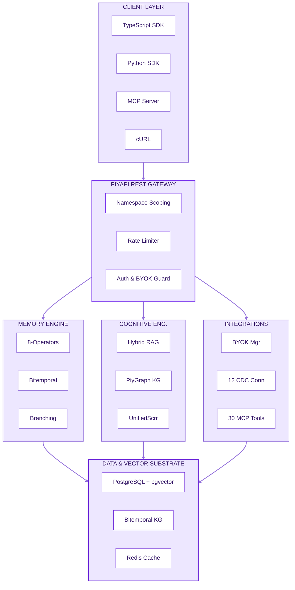

`POST /api/v1/context/retrieve`

## Core Concepts

<CardGroup cols={2}>
  <Card title="Persistent Memory" icon="database">
    Long-term storage referenced via memory_id . Backed by the Unified 8-Operator Surface .
  </Card>
  <Card title="Context" icon="layers">
    Assembled data passed via context object. Token-budget-aware context assembly for LLM system prompts via POST /api/v1/context/retrieve .
  </Card>
  <Card title="Users & Sessions" icon="users">
    Scoped via user_id identifiers. Enterprise multi-tenancy enforced via strict namespace isolation ( X-Namespace-Prefix header) and automated PHI/PII privacy redaction.
  </Card>
  <Card title="Retrieval" icon="brain-circuit">
    Query via client.search() . Hybrid search engine combining dense vector similarity (HNSW via pgvector ) and BM25 trigram full-text search, fused using Reciprocal Rank Fusion ( RRF_K=30 ).
  </Card>
  <Card title="Knowledge" icon="network">
    Structured domain data accessible through knowledge.query() . PiyGraph Knowledge Graph tracking real-world validity ( valid_at ) separately from system recording time ( system_at ).
  </Card>
</CardGroup>

## Architecture

PiyAPI decouples cognitive and storage workloads to deliver sub-millisecond retrieval alongside durable state management across millions of concurrent users.



## Initialize the Client

Connect to PiyAPI through our official SDKs or raw REST requests. Supply your API key generated from the dashboard.

<CodeGroup>

```javascript client.js
import { PiyAPIClient } from '@piyapi/sdk';

const client = new PiyAPIClient({
  apiKey: process.env.PIYAPI_API_KEY || 'sk_live_...'
});
```

```python client.py
from piyapi_memory import PiyAPIClient

client = PiyAPIClient(api_key="sk_live_your_key_here")
```

```bash verify.sh
curl -s https://api.piyapi.cloud/api/v1/verify \
  -H "Authorization: Bearer sk_live_..."

# Response: {"status":"valid","key_id":"...","scopes":["memory:read","memory:write"]}
```

</CodeGroup>

| **#** | **Step** | **Description** |
| :-- | :-- | :-- |
| 01 | Capture | Conversational or event data enters the system via API, SDK, or one of 12 native CDC connectors (Google Drive, Notion, GitHub, Slack, Jira, Gmail, and more). |
| 02 | Store | Relevant information is persisted as memory in PostgreSQL + pgvector , tagged and indexed for instant retrieval. |
| 03 | Retrieve | The UnifiedScorer evaluates 11 signals in a single pass — including vector similarity, BM25 text score, recency decay, entity overlap, contradiction penalty, and pin weight. |
| 04 | Compose context | Retrieved memory is assembled into a token-budget-aware context payload via POST /api/v1/context/retrieve . |
| 05 | Generate response | Context is passed to the model for output. Route through BYOK to use your own OpenAI, Anthropic, Gemini, or DeepSeek keys natively. |

## Store and Retrieve Context

A typical lifecycle integrates continuous memory persistence with targeted contextual recall before each model completion:

<CodeGroup>

```javascript example.js
const memory = await client.memories.create({
  content: 'User prefers dark mode UI and works primarily with React and TypeScript.',
  tags: ['preferences', 'tech-stack'],
  metadata: { source: 'onboarding_chat', user_id: 'usr_9918' }
});
```

```javascript example.js
const results = await client.search({
  query: 'What frontend framework does the user prefer?',
  limit: 5,
  min_score: 0.25
});
```

</CodeGroup>

## How PiyAPI Works

The five-stage pipeline transforms raw multi-turn dialogue into high-signal context vectors with bitemporal validity:

## What's Next?
